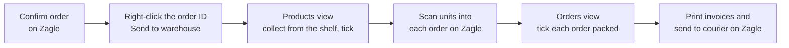
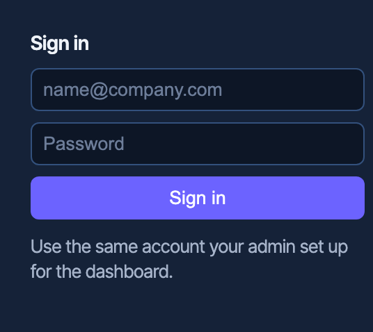
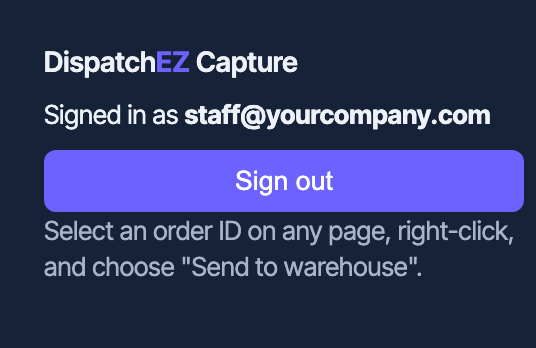
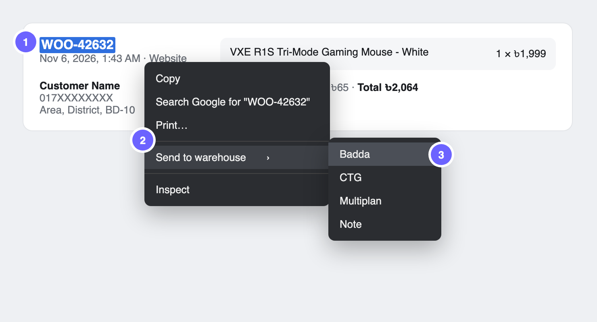
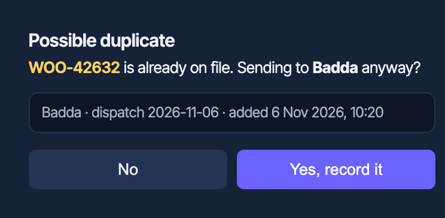
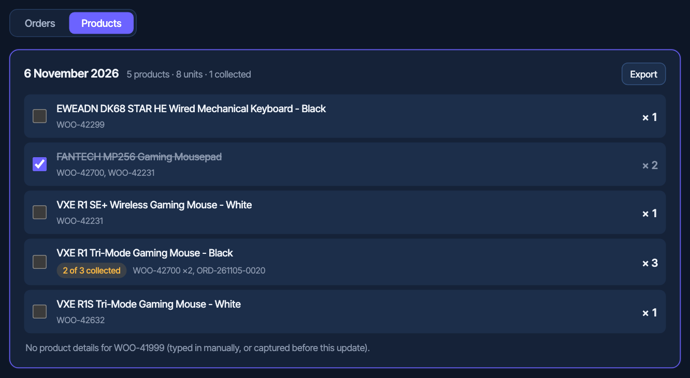
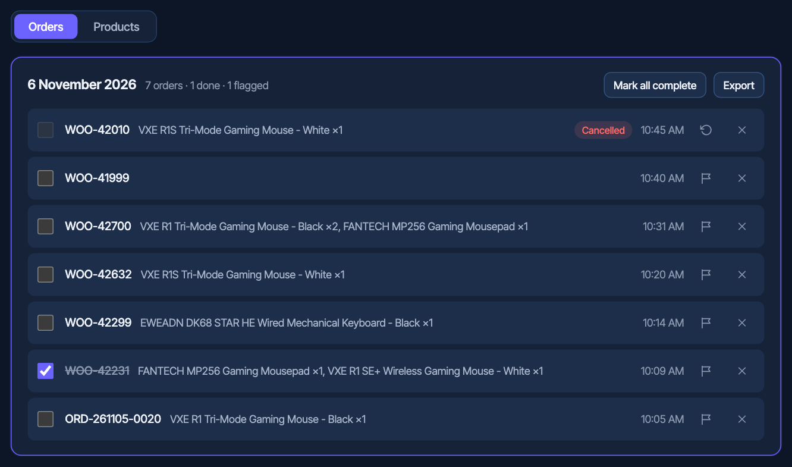
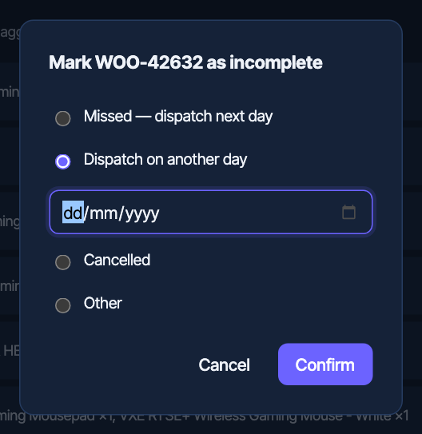
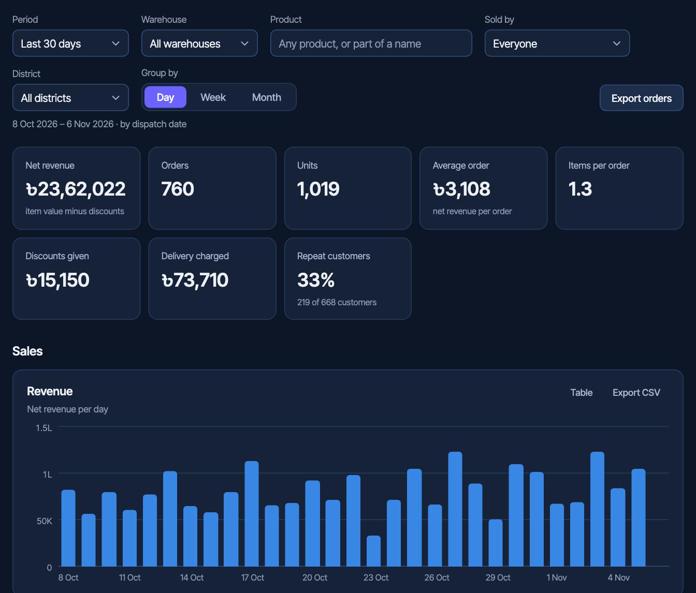

# DispatchEZ

Order-dispatch tracker for routing confirmed orders to warehouses. Right-click
an order on Zagle and it lands in a shared, real-time dashboard with its
products, a pick list for the warehouse, and statistics for the business.

**Live:** [dispatchez.vercel.app](https://dispatchez.vercel.app/)

**Jump to:** [Team guide](#team-guide) · [Admin: sharing the extension](#admin-sharing-the-extension) · [Features](#features) · [Developer setup](#developer-setup)

---

## Team guide

Everything you need to install the capture extension and use DispatchEZ day to day.



### 1. Install the extension (once, about 5 minutes)

Works in **Brave** and **Google Chrome**. Your admin will send you a file called
`DispatchEZ-Capture-0.2.0.zip`.

| Step | What to do |
|---|---|
| 1 | **Unzip it** somewhere permanent, e.g. `Documents`. You'll get a folder called `DispatchEZ-Capture`. **Don't move or delete this folder later.** The browser runs the extension from it. |
| 2 | **Open the extensions page.** Paste `brave://extensions` (Brave) or `chrome://extensions` (Chrome) into the address bar and press Enter. |
| 3 | **Turn on Developer mode** with the switch in the top-right corner. |
| 4 | **Click Load unpacked** and choose the `DispatchEZ-Capture` folder (the one with `manifest.json` inside). |
| 5 | **Pin it.** Click the puzzle-piece icon next to the address bar, then the pin next to *DispatchEZ Capture*. |
| 6 | **Sign in.** Click the DispatchEZ icon and use the same email and password you use for the dashboard. |

<table>
<tr>
<td align="center"><br/><sub>Step 6: sign in</sub></td>
<td align="center"><br/><sub>Done: you're signed in</sub></td>
</tr>
</table>

> If the browser warns about *developer mode extensions*, that's because this
> extension is installed from a folder rather than the Chrome Web Store. Keep it on.

### 2. Send an order to a warehouse

On **Zagle's orders list**:

1. **Select the order ID** (double-click it).
2. **Right-click** it, then choose **Send to warehouse**.
3. **Pick the warehouse.**

That's all. The extension reads the rest of the order card by itself:
products, quantities, prices, discount, delivery, customer, phone, address,
district, website or manual (and who sold it), coupon, and courier.



**Check the badge on the DispatchEZ icon after sending:**

| Badge | Meaning | What to do |
|---|---|---|
| 🟢 **✓** | Saved with all its details. | Nothing. |
| 🟠 **ID** | Only the order ID was saved. The selection wasn't inside a Zagle order card, or it ran into the next card. | Select just the order ID and try again. If it keeps happening on Zagle, tell your admin. |
| 🔴 **!** | Not saved. | Usually you sent it to a warehouse you're not assigned to (staff can only send to their own warehouse). Otherwise you're signed out or offline. |

**Already sent?** If that order ID is already in DispatchEZ, a small window
shows where and when it was recorded. **No** cancels and nothing changes.
**Yes, record it** saves it again on purpose.



**Tips**
- Select **only the order ID**. Selecting the whole card also works, but don't
  drag across two orders.
- Selecting **only a product name** sends just that name, which is the old
  *Note* pick-list habit. You don't need it any more.

### 3. Pick and pack in the dashboard

Open your warehouse tab in [the dashboard](https://dispatchez.vercel.app/).
Use the **Orders | Products** switch above the date cards.

**Products: collecting from the shelf.** Every product across that day's
orders, with the total quantity and the orders it belongs to. Tick a product
once you've collected it. If another order for it comes in after you ticked,
it shows **"2 of 3 collected"** so nothing gets missed.



**Orders: packing and dispatch.** One row per order with its products. Tick
an order when it's packed or dispatched.



**Export** (top right of each date card):

| On the… | Export gives you |
|---|---|
| Orders tab | `WOO-42632 - VXE R1S Tri-Mode Gaming Mouse - White x 1, FANTECH MP256 Gaming Mousepad x 2` (one line per order) |
| Products tab | `VXE R1 Tri-Mode Gaming Mouse - Black x 3` (one line per product, the pick list) |

The file downloads and is also copied, ready to paste.

### 4. When an order can't go out today

Click the **flag** on the order, then choose:

| Option | Use it when |
|---|---|
| **Missed — dispatch next day** | It didn't make it today; move it to tomorrow. |
| **Dispatch on another day** | The customer wants it later. Pick the date, e.g. dispatch on the 9th for delivery on the 10th. |
| **Cancelled** | The order is off. |
| **Other** | Anything else. Add a short note. |

Moved orders show **"Moved to 9 November"** on the old day and
**"moved from…"** on the new one. Their products move with them.



### 5. Statistics (admins only)

The **Statistics** tab has revenue, units, average order value, website vs manual
sales (per salesperson), coupons, when customers order, top sellers, slow movers,
variants, brands, products bought together, warehouse load, districts and repeat
customers.

- **Filters:** period, warehouse, product (type part of a name, e.g. *Dragonfly*),
  sold by (e.g. *Fardeen*), district (e.g. *Dhaka*), and Day/Week/Month.
  Weeks start on Wednesday.
- **Exports:** **Export orders** downloads every order matching the filters.
  **Export CSV** on any card downloads that card's data. Both open in Excel and
  Google Sheets.



> Statistics only include orders sent with the extension (version 0.2.0 or
> later), because that's where the product and customer details come from.

### Updating the extension

When your admin sends a new zip:

1. Unzip it and **replace everything inside** your existing `DispatchEZ-Capture`
   folder with the new files. Keep the same folder.
2. Go to `brave://extensions` (or `chrome://extensions`) and click the **reload ↻**
   icon on *DispatchEZ Capture*.
3. Check the version number on the card matches the one your admin mentioned.

### Something's not working

| Problem | Fix |
|---|---|
| No **Send to warehouse** in the right-click menu | Click the DispatchEZ icon and make sure you're signed in. The menu only appears when text is selected. |
| A new warehouse is missing from the menu | The menu refreshes every 30 minutes. To refresh now, sign out and back in. |
| Red **!** badge | Check you're sending to your own warehouse. Then check you're signed in and online. |
| The extension disappeared | The `DispatchEZ-Capture` folder was moved or deleted. Put it back (or unzip again) and click **Load unpacked** again. |

---

## Admin: sharing the extension

### Now: send a zip

1. Make the zip from the repo (macOS Terminal, in the project folder):

   ```bash
   VERSION=$(grep -o '"version": "[^"]*"' copy-extension/manifest.json | cut -d'"' -f4)
   rm -rf /tmp/DispatchEZ-Capture && cp -R copy-extension /tmp/DispatchEZ-Capture
   (cd /tmp && zip -rX ~/Desktop/DispatchEZ-Capture-$VERSION.zip DispatchEZ-Capture -x '*.DS_Store')
   ```

   The zip lands on your Desktop, named with the version from `manifest.json`.
2. Send it to the team with a link to the [Team guide](#team-guide).
3. For every update, bump `"version"` in `copy-extension/manifest.json`, make a
   new zip, and send it with the [update steps](#updating-the-extension).

Limits of this route: everyone installs and updates by hand, and the browser
may show a developer-mode warning.

### Later: one-click install from the Chrome Web Store

Publishing as **Unlisted** means only people with the link can find it. Installing
is then one click on **Add to Chrome / Add to Brave**, with no developer mode, and
**updates install automatically**.

What it takes:
- A Chrome Web Store developer account: a **one-time $5** registration fee.
- A **privacy policy** page, since the extension handles customer details (names,
  phones, addresses). A simple hosted page is enough.
- Google's **review**, which usually takes from a few hours to a few days. Each
  later update is reviewed too.
- Upload the same `copy-extension` zip, choose **Unlisted** visibility, and share the
  store link.

---

## Features

- **One-click capture from Zagle** — select an order ID on Zagle's orders
  list, right-click, send to a warehouse. The extension reads the whole order
  card: products, quantities, prices, discount, delivery, customer, address,
  district, source / salesperson, coupon and courier.
- **Duplicate warning** — sending an order ID that's already recorded shows
  where and when it was recorded, and asks before saving it again. The check
  runs in the database, so it can't be skipped, and two people sending the same
  order at once can't both slip through.
- **Products pick list** — an Orders | Products switch on every warehouse:
  the products across a day's orders with total quantities, tick-to-collect,
  and "2 of 3 collected" when more orders arrive after a tick.
- **Warehouse tabs** — dynamic, driven by a `warehouses` table, not
  hardcoded. Add a new warehouse from the dashboard and it shows up
  everywhere (including the extension's context menu) without a redeploy.
- **Manual add box** in the dashboard as a second entry point, with
  Enter-to-submit for fast repeated entry.
- **Date-grouped orders** — each day gets its own card with a live count,
  a "mark all complete" bulk action, and export (orders with their products,
  or the pick list) to a `.txt` file and the clipboard.
- **Incomplete orders** — mark an order missed (moves to the next day),
  dispatch on another chosen day, cancelled, or other with a note.
- **Real-time sync** — every connected browser sees new/updated/deleted
  orders and pick-list ticks instantly via Supabase Realtime.
- **Role-based access** — `super_admin` sees and manages every warehouse;
  `staff` land directly on their assigned warehouse, can browse others
  read-only, and can only add/edit/delete within their own. Enforced by
  Postgres Row Level Security, not just UI conditionals — the rules hold
  even if the frontend has a bug.
- **Statistics** (super_admin only) — revenue, units, average order
  value, website vs manual sales (per salesperson), coupons, order-time
  heatmap, top sellers and slow movers, variant and brand split, products
  bought together, warehouse load, districts, and repeat customers. Filter by
  date range, warehouse, product, salesperson and district; export any card
  or the full order list as CSV.
- **Personal notes** — a private, autosaving scratchpad per user.
- **Pre-book tracking** — a separate tab for incoming stock: create a
  pre-book batch for a product against an expected arrival date, claim
  customer orders against it as they come in, and see stock/claimed/
  available at a glance.
- **Admin panel** (`/admin`, super_admin only) — create staff accounts,
  assign roles/warehouses, and add warehouses, all from the UI.

## Tech stack

| Layer      | Choice                                    |
|------------|--------------------------------------------|
| Frontend   | Vite + vanilla JS                          |
| Backend    | Supabase (Postgres, Auth, Realtime, RLS)   |
| Hosting    | Vercel                                     |
| Extension  | Chrome/Brave, Manifest v3                  |

Built with the same stack as its sibling tool,
[messenger-capture](https://github.com/samin-isnotavailable/messenger-capture).

## Roles

- **super_admin** — sees every warehouse, is the only role that can add
  new warehouses, can add/edit/delete orders in any warehouse, and sees
  Statistics.
- **staff** — lands on their assigned warehouse on login, can browse
  other warehouses read-only, can only add/check off orders in their own
  warehouse.

---

## Developer setup

### 1. Supabase

1. Create a free project at [supabase.com](https://supabase.com).
2. Open the SQL editor and run, in order:
   - `supabase/migrations/0001_init.sql` — creates `warehouses`,
     `profiles`, `orders`, sets up RLS, and seeds a few starter
     warehouses.
   - `supabase/migrations/0002_notes.sql` — adds the personal notes
     table.
   - `supabase/migrations/0003_products_brand.sql` — adds an optional
     `brand` column to `products`, used to group the pre-book list by
     brand (falls back to the first word of the product name until
     backfilled).
   - `supabase/migrations/0004_order_capture_dedupe.sql` — adds the
     `capture_order` RPC that both capture paths (extension + manual add)
     call instead of inserting directly, so a previously-captured
     `order_id` triggers a duplicate-warning prompt instead of silently
     recording twice.
   - `supabase/migrations/0005_order_details_pick_list.sql` — saves each
     order's products, amounts and source alongside the ID (read from the
     Zagle order card at capture time), and adds the `pick_marks` table
     behind the dashboard's Products (pick list) view.
   - `supabase/migrations/0006_statistics.sql` — adds the `stats_dataset`
     function behind the Statistics tab.
   - `supabase/migrations/0007_statistics_exports.sql` — adds customer
     name, area and address to the statistics data, for exports.
3. **Authentication → Users** — create an account for yourself. This
   becomes your first `super_admin`; every account after this one can be
   created from the in-app Admin panel instead.
4. **Table editor → profiles** — for that first account, set:
   - `role` → `super_admin`
   - `warehouse_id` → leave blank
5. **Settings → API** — copy the **Project URL** and **anon public key**
   (you'll need both next).

### 2. Dashboard (local)

```bash
npm install
cp .env.example .env
# fill in VITE_SUPABASE_URL and VITE_SUPABASE_ANON_KEY
npm run dev
```

### 3. Deploy

Push to GitHub, import the repo in Vercel, and set these environment
variables in the Vercel project settings. Vercel auto-detects the Vite
build.

- `VITE_SUPABASE_URL` / `VITE_SUPABASE_ANON_KEY` — same values as `.env`.
  Tick **Preview** as well as **Production** so branch previews work.
- `SUPABASE_SERVICE_ROLE_KEY` — from Supabase **Settings → API**. Powers
  the `api/admin-create-user` and `api/admin-delete-user` serverless
  functions the Admin panel calls. Keep this server-side only — never
  prefix it with `VITE_`, which would expose it to the browser bundle.

### 4. Browser extension

1. Open `copy-extension/config.js` and fill in the same
   `SUPABASE_URL` / `SUPABASE_ANON_KEY` values as your `.env`.
2. Install it as described in the [Team guide](#1-install-the-extension-once-about-5-minutes),
   choosing the `copy-extension/` folder.

The context menu is built from the live `warehouses` table (refreshes
every 30 minutes, or immediately after sign-in), so new warehouses appear
without reinstalling the extension. The page is read by
`copy-extension/orderCardReader.js`, which finds fields by Zagle's labels and
attributes rather than CSS classes; if Zagle changes its order-card layout,
that file is the one to update.

---

## Project structure

```
dispatchez/
├── src/                      # Dashboard (Vite + vanilla JS)
│   ├── main.js
│   ├── auth.js
│   ├── dashboard.js          # warehouse tabs, Orders / Products views
│   ├── stats.js              # Statistics tab (filters, charts, exports)
│   ├── statsCompute.js       # Statistics calculations (no DOM)
│   ├── prebook.js            # pre-book batches + claimed-order tracking
│   ├── admin.js              # /admin panel (users, roles, warehouses)
│   ├── dialogs.js            # themed alert/confirm/prompt replacements
│   ├── icons.js              # inline SVG icon set
│   ├── supabaseClient.js
│   └── style.css
├── api/                      # Vercel serverless functions
│   ├── admin-create-user.js
│   └── admin-delete-user.js
├── copy-extension/           # Browser extension (Manifest v3)
│   ├── manifest.json
│   ├── background.js         # context menu, saves captures
│   ├── orderCardReader.js    # reads the Zagle order card
│   ├── confirm.html / .js    # "Possible duplicate" window
│   ├── authClient.js         # Supabase Auth REST calls + token refresh
│   ├── popup.html / popup.js
│   └── config.js
├── docs/images/              # screenshots used in this README
├── supabase/migrations/      # 0001 … 0007, run in order
└── index.html
```

## Roadmap

- Chrome Web Store (unlisted) listing for one-click install and auto-updates
- Look up an order's details from its ID alone (needs a Zagle API or webhooks)
- Per-warehouse export history / archive view

## License

[MIT](LICENSE) — use it, fork it, adapt it, just keep the copyright notice.
